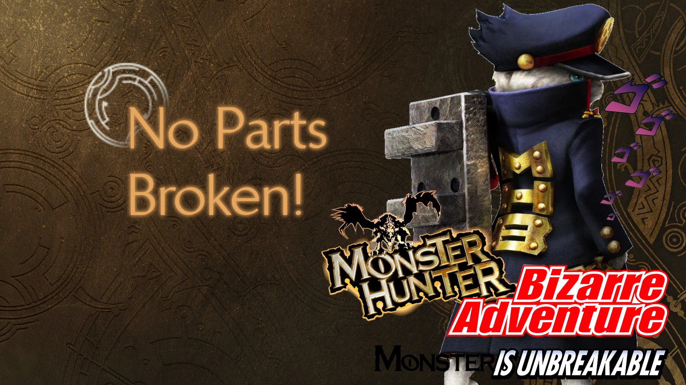

# No Part Break

**Monster Hunter Wilds · REFramework Lua mod**

Monsters can still be broken and severed. You just never see it.

---

Whenever I wanted to take screenshots for my mods, some monsters needed to reach a
certain damage threshold before entering a different stage or power state, where they
gain access to additional attacks, like Zoh Shia, Mizutsune and others.

The problem was that, by the time I reached those states, I had often broken parts of
their bodies along the way.

One of the hardest parts of making monster texture mods is dealing with **PB
(PartBroken) textures**. They are separate textures that can look completely out of
place if they are not done properly, and when something is wrong with them, it is
extremely noticeable.

**Well, that problem is over.**

This mod hides every broken, severed or dismantled monster body part. You can still
defeat monsters normally, and they still enter their different combat and powered-up
states.

In retrospect, it also works as a way to make hunts a little harder: you lose the
visual feedback of what you already broke, and nothing ever falls off for you to carve.

I don't know, use it however you want. Kisses! 🫰

> This is my first Lua mod, so be patient with me, you sons of a Wyverian. 😠

> Needless to say, this is veeeery likely to vary, but it's probably illegal... just
> saying. Play by yourself, love you lots. 😘

## ✨ What it does

| | |
|---|---|
| 🦴 **No broken parts on the model** | In every form, phase and rage state. |
| ✂️ **No severed parts** | Tails, tentacles and other severable parts stay on the model, and nothing drops to carve. |
| 🔕 **No break notification or break effect** | No "part broken" message, no break sparks. |
| ⚔️ **Breaks still work underneath** | They count, and monsters react to them as in the base game: phase changes, powered-up states and break-dependent mechanics. |
| 🌍 **Global** | Works for every large monster. It hooks shared engine and base-class code, so there are no per-monster lists to keep up to date. |

### Per-monster tweaks

A few monsters need a little extra care:

| Monster | What happens |
|---|---|
| **Jin Dahaad** | Its four iceplates (cranial, tail, abdominal, large exposed) **never break**. They keep glowing, and its ice attacks and nova keep their full strength. Harder by design. |
| **Gypceros** | Its head crest **never breaks**, so it always keeps its flash attack. |
| **Gogmazios** | The weapon on its back **drops as in the base game**. Its tar (lost in phase 3, regained with its nova) is never touched. |
| **Arkveld** | Its chain-blade wings are stored as combined states (joined / split / mixed × wing break). Broken states are swapped for their intact twin, so the wings look intact whatever the blade layout. |

All of these live in the `CONFIG` table at the top of the script (`keep_intact`,
`show_break`, `never_block`, `substitute`).

**Requirements:** [REFramework](https://www.nexusmods.com/monsterhunterwilds/mods/93)
and, recommended, [Fluffy Mod Manager](https://www.nexusmods.com/site/mods/818).

**With Fluffy Mod Manager**
1. Download this repository as a ZIP (`Code` → `Download ZIP`).
2. Put the ZIP in Fluffy's `Games\MonsterHunterWilds\Mods` folder (or drag it into Fluffy).
3. Refresh the mod list and enable **King Stormhold - No Part Break**.

**Manual**
Copy `reframework/autorun/NoPartBreak.lua` into `<game folder>/reframework/autorun/`.

> **Updating with Fluffy:** disable the mod first, replace the files, refresh the mod
> list, then enable it again. If you replace the files while the mod is enabled, Fluffy
> keeps both versions around.

## ✅ Tested monsters

Rathian · Rathalos · Guardian Rathalos · Gravios · Yian Kut-Ku · Gypceros · Congalala ·
Blangonga · Lagiacrus · Nerscylla · Gore Magala · Seregios · Gogmazios · Mizutsune ·
Guardian Fulgur Anjanath · Guardian Ebony Odogaron · Doshaguma · Guardian Doshaguma ·
Balahara · Chatacabra · Quematrice · Lala Barina · Rompopolo · Rey Dau · Uth Duna ·
Nu Udra · Ajarakan · Arkveld · Tempered Arkveld · Hirabami · Jin Dahaad · Xu Wu ·
Zoh Shia · Omega Planetes

Tested in single player only.

### Known limitations

- **Nu Udra:** severed parts stop glowing, even though they look intact.
- **Jin Dahaad:** once an iceplate reaches its break threshold, the game keeps trying
  to break it. The mod stops every attempt before anything happens, so nothing is
  visible.

## 🔧 How it works

For the curious (and for other modders)

Every monster model change goes through two engine managers:
`ace.model_parts_manager.ModelPartsManager2.setCondition` (mesh pieces) and
`ace.model_material_manager.ModelMaterialManager.setCondition` (materials). The mod:

1. Answers "not broken" to break queries (`cBreakParts.get_IsBreak`, `isBreakedType`,
   `checkBreakParts`, ...) while a monster rebuilds its appearance, so the game picks
   the intact pieces itself, in every form.
2. Blocks the model and material conditions a break event applies, and keeps them
   blocked for that model.
3. Learns each monster's severed-part conditions from `EmParamPartsLost` and blocks
   them wherever they are applied.
4. Blocks the lost-part spawn (`partsLoss` / `flyLostParts`), so there is nothing to carve.
5. Suppresses the break notification and the break effect.

Scope tracking is per game thread, because monsters update on several threads at once.

**Troubleshooting:** set `debug = true` in `CONFIG` to log every break, sever and
blocked condition to `re2_framework_log.txt` in the game folder. Keep `trace` and
`mesh_trace` **off**: they hook code shared by the whole engine and can freeze the game.

- **1.0**: Initial release.

I'm immensely grateful to:

- [NSA Cloud](https://next.nexusmods.com/profile/NSACloud2) for the Blender RE tools.
- [praydog](https://next.nexusmods.com/profile/praydog2) for [REFramework](https://www.nexusmods.com/monsterhunterwilds/mods/93).
- [FluffyQuack](https://next.nexusmods.com/profile/FluffyQuack) for [Fluffy Manager](https://www.nexusmods.com/site/mods/818).
- [AsteriskAmpersand](https://next.nexusmods.com/profile/AsteriskAmpersand?gameId=6993) for [Tex_Chopper](https://www.nexusmods.com/monsterhunterwilds/mods/352).
- [atrarch](https://next.nexusmods.com/profile/atrarch), thanks for the idea of creating custom paths for the textures. It really saved me then.
- The whole Monster Hunter Modding Discord community.
- And you, because I like doing this, and even more when you enjoy it and talk about it. Spread the word!

## License

[MIT](LICENSE) © KingStormhold
